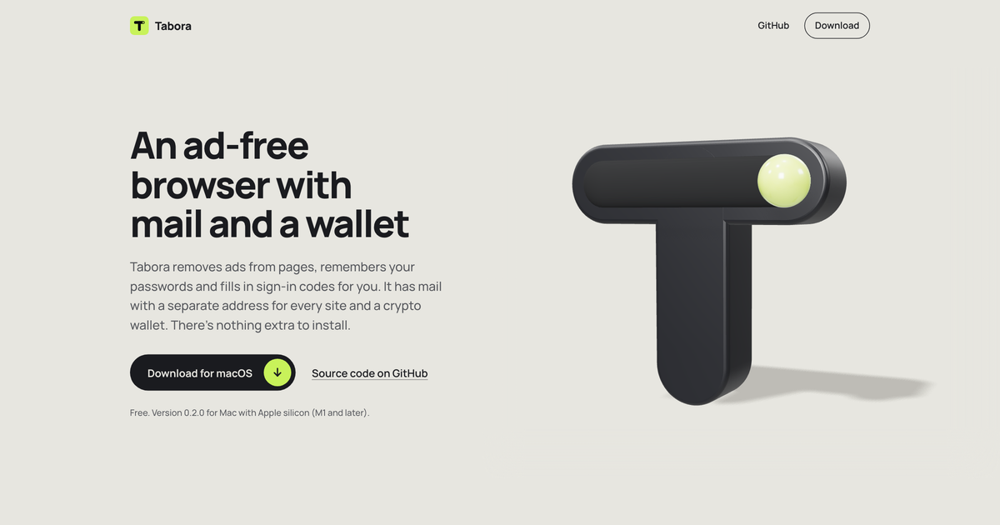

  

<h2 align="center">Tabora</h2>

  An ad-free browser with a password vault, sign-in codes, mail and a crypto wallet built in. 
  Open source, built on the Firefox engine.

  <a href="https://tabora.app"><b>tabora.app</b></a> ·
  <a href="https://tabora.app/#download"><b>Download for macOS</b></a> ·
  <a href="https://app.tabora.app"><b>Web mail</b></a>

---

### What Tabora does

- **Removes ads and trackers** from pages with its own blocker. Nothing to install.
- **Remembers passwords and fills in sign-in codes** (2FA) for you.
- **Has mail inside**: an `@tabora.app` mailbox, a separate alias for every site, OpenPGP encryption.
- **Has a crypto wallet**: Ethereum-compatible networks, Bitcoin, Solana, TRON.
- **Keeps work and personal life apart** with spaces: separate tabs and separate sign-ins.
- **Syncs your devices** with encryption that happens on the device: the server stores what it cannot read.
- **Sends nothing to Mozilla or anyone else**: no telemetry, no sponsored content.

### Repositories

| | |
|---|---|
| [**browser**](https://github.com/Tabora-App/browser) | The desktop browser (macOS) and the Android app, built from one engine, and the web app |
| [**ios**](https://github.com/Tabora-App/ios) | Tabora for iPhone |
| [**server**](https://github.com/Tabora-App/server) | The account server and the infrastructure of tabora.app |
| [**site**](https://github.com/Tabora-App/site) | The tabora.app website |

### Platforms

| macOS | Android | iPhone | Web |
|---|---|---|---|
| Released | In development | In development | Mail at [app.tabora.app](https://app.tabora.app) |

Everything is licensed under the [Mozilla Public License 2.0](https://www.mozilla.org/MPL/2.0/).
Tabora is an independent project and is not affiliated with Mozilla.
